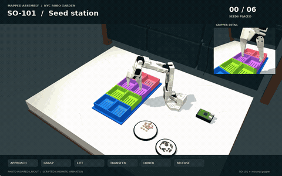
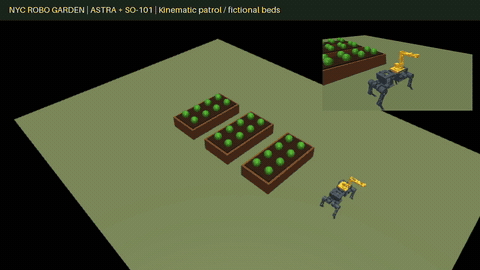
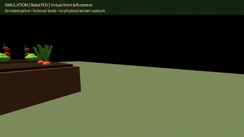

# NYC Robo Garden

**Robotics for small urban growers, starting with seed-tray planting.**

[Project homepage](https://nyc-robo-garden.vercel.app) · [NYC garden map](https://nyc-robo-garden.vercel.app/docs/gardens-map/) · [Run the demo](#run-the-simulated-garden-demo)

Judith “Judi” Desire, founder of **Uptown & Boogie Healthy Project**, described a recurring bottleneck: manually sowing seeds into individual tray cells can take hours. NYC Robo Garden explores how a small, programmable robot could help with that work while giving communities a practical way to learn robotics and AI.

Built for the **Physical AI for Good** track at the [Spooky Civic AI Hackathon](https://luma.com/onzzmytl), October 23–25, 2026.

## See the seed-station demo

[](docs/media/seed-station-simulation.gif)

**Simulation:** a 44-second scripted seed-handling sequence with an SO-101 arm. Seeds attach and release on a timeline. **Physical seed-placement validation is pending.**

## What works today

| Capability | What you can explore |
| --- | --- |
| Seed-station simulation | The illustrated pick-and-place sequence above. |
| Mobile garden simulation | An ASTRA quadruped carrying an SO-101 through a scripted harvesting mission, with an interactive browser view. |
| Garden discovery and scene generation | A searchable NYC garden map, versioned registry, and evidence-aware Open-Industries scene tools. |
| Hardware connection and observation tools | Viam resource inspection and a dual-camera viewer; setup details below. |

The next milestone is a measured physical seed-placement trial. The current simulations demonstrate motion and task sequences; they do not establish autonomous planting or harvesting.

## Table of contents

| Start here | Explore the details |
| --- | --- |
| [Seed-station demo](#see-the-seed-station-demo) | [Grower background](#introduction) |
| [What works today](#what-works-today) | [Seed placement: simulation and physical evidence](#seed-placement-simulation-vs-physical-execution) |
| [Run the simulated garden demo](#run-the-simulated-garden-demo) | [Mobile garden patrol and roadmap](#near-future-goal-autonomous-garden-patrol) |
| [Choose your next step](#choose-your-next-step) | [Garden data and scene generation](#nyc-robo-garden--urban-agriculture-network) |
| | [Real garden reference](#real-garden-reference--october-26) |
| | [OpenCode scene authoring](#author-garden-spaces-with-opencode) |
| | [Research and validation](#why-embodied-automation-remains-an-open-scientific-and-engineering-problem) |
| | [Small-farm context and economics](#problem-statement) |
| | [Community and education goals](#longer-term-community-impact) |
| | [Sponsor configuration](#sponsor-configuration) |
| | [Sponsors and project use](#sponsors-and-project-use) |
| | [Hackathon tracks](#hackathon-tracks) · [Event logistics](#event-logistics-and-submission) |

<a id="start-the-autonomous-farm-demo"></a>

## Run the simulated garden demo

```bash
pip install -r requirements-simulation.txt
python -m simulation.server
```

Open **http://127.0.0.1:8080**. The ASTRA dog carries the mounted SO-101 arm,
moves through a simulated sequence at three crop beds, attaches a carrot, lettuce and tomato, places each in its
collection box, and returns home. The 72-second harvesting mission repeats continuously.
The server owns the mission; opening or refreshing the dashboard does not restart it.
The browser renders the actual robot meshes with Three.js/WebGL, interpolating
30 Hz pose updates at the display refresh rate. Drag to orbit, scroll to zoom,
or use **Follow action**. The backend does not render or encode video frames.
This is a **kinematic simulation** with scripted produce attachment/release and
joint-limited inverse kinematics, not physical robot control or grasp-contact validation.
See [the farm mission guide](docs/garden-patrol.md#server-driven-harvesting-mission).

## Choose your next step

| Goal | Entry point |
| --- | --- |
| Explore NYC gardens without installing anything | [NYC Garden Explorer](https://nyc-robo-garden.vercel.app/docs/gardens-map/) |
| Inspect the mobile simulation and export media | [Garden patrol guide](docs/garden-patrol.md) |
| Connect the SO-101 through Viam | [Viam setup below](#sponsors-and-project-use) |
| View the physical cameras | [Dual-camera viewer setup](pi-arm4-camera/README.md) |
| Build a garden scene | [Scene adapter guide](docs/garden-scene-adapter.md) · [OpenCode authoring](docs/opencode-authoring.md) |
| Review the physical experiment plan | [Physical validation plan](docs/embodied-ai-research.md#physical-validation-plan) |

**Roadmap:** validate seed placement at a fixed station, then integrate observation and recovery before extending to autonomous garden patrol.

Each section below expands once to reveal its details. Subsections remain visible inside the expanded section.

## Introduction

<details>
<summary>Grower background and the seed-tray problem</summary>

During the hackathon, we worked with **Judith “Judi” Desire, founder and executive director of Uptown & Boogie Healthy Project**, to understand a recurring task in her work as a small-scale urban grower. She described a major pain point: **manually sowing seeds into the individual cells of seedling trays can take hours**. That firsthand conversation gave our team a specific, practical problem to address.

[Uptown & Boogie Healthy Project's mission](https://ubhp.org/about/) combines fair access to food with economic opportunity in Harlem and the Bronx: helping residents obtain affordable, fresh produce and preparing young adults for work in agricultural businesses, city farming, and food-related technology. Judi's growing work includes seedling production and a community greenhouse at St. Nicholas Miracle Garden. [Grower background](https://blackfarmerfund.org/rapid-response-fund-recipients/uptown-boogie-healthy-project)

**Our scope for this hackathon was to understand this frequently repeated task and develop a robotic approach to automating seed placement in trays.** Working from a small-scale grower's needs keeps the project focused on an everyday bottleneck. The intended benefit is to free time for other growing and community activities while making the same workstation a practical setting for learning robotics and AI. The sections below distinguish that objective from what the prototype currently demonstrates.

</details>

## Seed Placement: Simulation vs. Physical Execution

<details>
<summary>Prototype scope, evidence boundaries, and physical validation</summary>

**Current primary objective: automate seed placement into seedling trays using the Viam SO-101 robotic arm.** We are developing an engineering research platform around that task; reliable autonomous seed placement has not yet been established by the evidence below.

| Scope | What exists or is intended | Evidence boundary |
| --- | --- | --- |
| Current tooling | SO-101/Viam connection and camera tools, scene authoring, registry and simulation code | Tool availability does not establish a completed physical planting workflow. |
| Current simulation | Station-based seed handling; ASTRA quadruped carrying a mounted SO-101; scripted garden manipulation | Kinematic scenes and illustrative object attachment, not measured grasping or field autonomy. |
| Near-future goal | Autonomous garden patrol with observation and validated planting, tending and harvesting skills | Navigation, perception, balance and task reliability still require integration and physical trials. |
| Longer-term vision | Affordable, reusable embodied-AI infrastructure for community agriculture, education and local economic opportunity | Affordability, learning outcomes and economic benefits are hypotheses to evaluate. |

**Physical hardware demonstration: pending.** The [seed-station demo above](#see-the-seed-station-demo) illustrates the intended sequence. No physical seed-placement footage is supplied here. Physical trials will measure misses, doubles, seed damage and interventions.

The exact October 24 station GIF was recovered and optimized for this page, preserving the full 44-second sequence. Its illustrative seeds attach and release on a timeline; motion within joint limits is not contact validation. A linked hardware recording can be added here once available. [Media provenance and replacement instructions](docs/media/README.md) · [Physical validation plan](docs/embodied-ai-research.md#physical-validation-plan)

</details>

## Near-Future Goal: Autonomous Garden Patrol

<details>
<summary>Patrol videos, implementation details, and autonomy roadmap</summary>

**Concept — proposed workflow:** an autonomous quadruped navigates garden beds, observes crops and uses a mounted SO-101 for **validated** planting, tending and harvesting operations. Each skill must first pass task-specific physical trials. The current patrol below is a visualization of the mobile platform, not that complete autonomous system.

<table>
  <tr><th width="50%">Third-person view</th><th width="50%">Robot POV</th></tr>
  <tr>
    <td valign="top"><a href="docs/media/garden-patrol.mp4"></a><br><strong>Simulation.</strong> Existing patrol animation; scripted leg motion and fixed arm mount. Click for the original video.</td>
    <td valign="top"><a href="docs/media/garden-patrol-pov.mp4"></a><br><strong>Simulation.</strong> Virtual sensor viewpoint rendered from the same patrol model. No physical camera capture or perception inference. Click for video.</td>
  </tr>
</table>

The POV is fixed to an illustrative front-left sensor location on the chassis; it is not a calibrated model of an installed camera. Both views cover the same 36-second scripted route. [Renderer, provenance and viewing details](docs/media/README.md)

| Proposed step | Implemented simulation or tooling | Still required for autonomous physical operation |
| --- | --- | --- |
| 1. Load a garden layout or scene | Fictional three-bed scene; separate evidence-aware scene-authoring tools | Integrate an operator-approved, surveyed layout; the NYC map does not automatically become this simulation. |
| 2. Plan a route through beds | Predefined closed route and scripted mission waypoints | Traversability, obstacle-aware planning and replanning. |
| 3. Navigate between task locations | Assigned chassis poses and scripted leg motion | Localization, balance, collision avoidance, payload and terrain validation. |
| 4. Observe crops with an onboard camera | Rendered virtual POV; separate camera utilities | Mount/calibrate a physical camera and integrate observations into control. |
| 5. Identify a candidate task | Scripted crop targets and task order | Perception, task eligibility, uncertainty thresholds and human escalation. |
| 6. Position the arm and execute a validated manipulation | Joint-limited arm IK and scripted produce attachment in the harvesting demo | Reach/collision checks, tooling, visual feedback and task-specific physical validation. |
| 7. Verify completion and record evidence | Simulation mission log; attachment state is scripted | Independent outcome sensing, dated hardware footage, failures and recovery records. |
| 8. Continue patrol or return home | Scripted continuation and return in the harvesting mission | Battery-aware decisions, fault recovery and validated return/docking behavior. |

The downloadable patrol clip illustrates carrying the arm; the separate interactive harvesting mission demonstrates scripted manipulation. Neither establishes grasp/contact dynamics, autonomous crop recognition, real navigation, physical balance or agricultural reliability. [Simulation guide](docs/garden-patrol.md) · [Outstanding scene/pilot work: #4](https://github.com/isayahc/Spooky-Civic-AI-Hackathon/issues/4), [#9](https://github.com/isayahc/Spooky-Civic-AI-Hackathon/issues/9), [#10](https://github.com/isayahc/Spooky-Civic-AI-Hackathon/issues/10)

</details>

## NYC Robo Garden — Urban Agriculture Network

<details>
<summary>Garden map, data pipeline, scene generation, and pilot-site criteria</summary>

NYC Robo Garden explores how community-oriented agricultural robotics could support urban growers, education, and shared food-growing spaces. New York City has many community gardens, but **a listed garden is not necessarily a greenhouse, an active food-production site, or an approved robotics deployment location**.

### Find gardens and urban agriculture sites

| Resource | What it provides | How we could use it |
| --- | --- | --- |
| [NYC Parks GreenThumb](https://www.nycgovparks.org/greenthumb) | Official NYC community-gardening program | Learn about participating gardens and community stewardship |
| [NYC GreenThumb Garden Info (NYC Open Data)](https://data.cityofnewyork.us/dataset/GreenThumb-Garden-Info/p78i-pat6) | Public garden records, including geospatial information | Build a filterable site-discovery map |
| [GreenThumb garden locations (GeoJSON)](https://data.cityofnewyork.us/resource/p78i-pat6.geojson) | Machine-readable garden geography | Load candidate points into GIS or a web map; check API pagination/limits before assuming complete coverage |
| [NYC Mayor's Office of Urban Agriculture](https://www.nyc.gov/site/agriculture/) | Citywide urban-agriculture programs and resources | Discover urban farming partners and additional site information |
| [New York Restoration Project — Community Gardens](https://www.nyrp.org/en/get-involved/community-gardens/) | Community gardens supported by NYRP | Identify potential organizational partners |

### Interactive NYC garden map

**[Open the NYC Garden Explorer](https://nyc-robo-garden.vercel.app/docs/gardens-map/)** — a lightweight SVG map with simplified outlines of all five boroughs and public GreenThumb garden locations. Search by name, address or Parks ID; filter by borough and status; select a garden to inspect its available source footprint.

The map loads a bundled snapshot with 635 source records, 579 location markers, and 56 records without coordinates. It uses no street tiles, third-party scripts, or runtime NYC Open Data requests. Source rows are not deduplicated garden counts; records without coordinates remain searchable. Garden markers are public dataset records, not verified greenhouse sites or deployment permissions. Refresh the snapshot with `python scripts/build_garden_map.py`.

The root `index.html` is the project homepage, with styles in `site.css`. Vercel serves the repository as a static site using `vercel.json`. For a local preview, run `python -m http.server 8000` from the repository root and open `http://localhost:8000/`.

### Versioned garden data

The [garden registry pipeline](docs/garden-registry.md) ingests GreenThumb records into typed, versioned data with stable Parks IDs, source metadata and deduplication. It keeps location points, source polygons and optional BBL-matched tax lots distinct.

```bash
python3 -m garden_registry --output data/generated
python3 -m unittest discover -s tests -v
```

### Layout, infrastructure and produce evidence

The [evidence research contract and importer](docs/garden-evidence.md) attach dated, cited claims to registry sites while keeping ambiguous matches and unknowns separate. The initial sample includes a historical bed-addition report; it does not establish current layouts or utility availability.

### Mounted arm garden patrol demo

See the [side-by-side simulation views and autonomy roadmap](#near-future-goal-autonomous-garden-patrol).

[Watch the robot dog carry the SO-101 arm around three garden beds](docs/media/garden-patrol.mp4). [Run the interactive model or export a video](docs/garden-patrol.md). This uses the actual robot meshes and a fixed mount, with scripted leg motion and a closed patrol route. It is kinematic playback in a fictional garden; physical balance and payload capacity are not validated.

### Generate an Open-Industries scene

The [garden scene adapter](docs/garden-scene-adapter.md) converts an explicit garden manifest into OI-native LOD0/LOD1 geometry, preserves evidence and WGS84 georeferencing, and supports OI 3D Tiles export plus MCP asset bindings. Start with the clearly fictional fixture:

```bash
python3 -m garden_registry.scene_adapter build data/scenes/fictional-garden.json --output data/generated/garden-demo
python3 -m garden_registry.scene_adapter reload data/generated/garden-demo
```

A real registry record needs an explicitly sourced footprint before generation. Procedural surfaces and envelopes remain labeled inferred.

### Proposed pilot-site screening

Start with **Brooklyn** and expand across the five boroughs. Evaluate candidate locations using information confirmed by the site operator:

- Garden name, location, contact organization, and permission to engage
- Food-growing activities and whether a greenhouse or controlled-environment space exists
- Water, electrical power, connectivity, and physical access
- Robot operating area, pedestrian access, supervision, and safety constraints
- Community value: education, tending, monitoring, harvesting, and shared meals

### Potential applications

- Environmental and soil sensing
- Assisted watering and garden maintenance
- Documented robotic task demonstrations
- Plant monitoring and educational workshops
- Farm-to-kitchen community events

**Project status:** These are discovery resources and candidate evaluation criteria, not confirmed deployment partners. Site suitability, permissions, and greenhouse availability require direct verification.

</details>

## Real garden reference — October 26

<details>
<summary>St. Nicholas Miracle Garden geometry and outstanding measurements</summary>

[St. Nicholas Miracle Garden](docs/garden-layout-audit.md) is the selected boundary reference: original NYC Parks geometry, a separate MapPLUTO comparison, and nine explicitly unknown interior categories. [Open the reference viewer](docs/garden-reference/index.html) or [download the native Open-Industries scene](data/scenes/st-nicholas-boundary/garden.oi.json). This is a source-backed outline with inferred flat rendering; measured beds, greenhouse placement and robot clearances are pending. The audit compares seven candidates and specifies the measurements and permissions needed for the seed-tray pilot.

</details>

## Author garden spaces with OpenCode

<details>
<summary>OpenCode and Open-Industries MCP authoring setup</summary>

Connect OpenCode to the local Open-Industries MCP server and use `/author-space`
to generate, validate, save and export conceptual garden layouts. Setup, the
committed sample, and a model-free MCP replay are in
[OpenCode space authoring](docs/opencode-authoring.md).

</details>

## Why Embodied Automation Remains an Open Scientific and Engineering Problem

<details>
<summary>Research: manipulation, sim-to-real, and validation</summary>

Recognizing a crop is only one part of acting on it: agricultural harvesting combines perception, navigation, motion planning, end-effector design and grasping, each with unresolved deployment challenges. [Droukas et al., 2023](https://doi.org/10.1007/s10846-022-01793-z) **NYC Robo Garden exposes these engineering questions; it has not solved them.**

| Research challenge | What research establishes | What we need to test here |
| --- | --- | --- |
| Generalization across environments, objects and tasks | Open X-Embodiment pooled data from **22 robots, 21 institutions and 527 skills**, demonstrating positive transfer across tested platforms; this is not universal task competence. [Open X-Embodiment Collaboration, 2024](https://arxiv.org/abs/2310.08864) | Hold out seed types, trays, lighting and layouts; report failures as well as successful trials. |
| Detection versus manipulation; visual servoing | KOVIS uses repeated image feedback for fine manipulation and demonstrates selected real tasks after simulation training, including insertion with **4 mm clearance**. That result is not seed-placement accuracy. [Puang et al., 2020](https://doi.org/10.1109/IROS45743.2020.9341370) | Evaluate detection separately from pickup, transport, release and correct-cell verification; measure camera-to-arm alignment and drift. |
| Sim-to-real transfer | A survey identifies simulation mismatch and reviews transfer methods such as domain randomization and adaptation. [Zhao et al., 2020](https://doi.org/10.1109/SSCI47803.2020.9308468) | Measure physical reach, timing, slip and contact; an animated trajectory alone cannot validate transfer. |
| Contact, small objects and deformable material | Agricultural gripper design and deformable-object research show why manipulation depends on the interaction with the object, including shape/material estimation and control. [Droukas et al., 2023](https://doi.org/10.1007/s10846-022-01793-z) · [Arriola-Rios et al., 2020](https://doi.org/10.3389/frobt.2020.00082) | Test seed singulation, friction and damage; treat soil, seedlings and leaves separately from rigid seed props. |
| Long-horizon planning, uncertainty and recovery | Inner Monologue reports improved instruction completion with environment feedback in three tested domains; planning depends on available skills and feedback. [Huang et al., 2023](https://proceedings.mlr.press/v205/huang23c.html) | Detect failed or uncertain placements, retry within limits, stop for assistance and record evidence instead of assuming success. |
| Hardware reliability and unstructured agriculture | The harvesting survey treats sensing, navigation, hardware and operation planning as coupled challenges. [Droukas et al., 2023](https://doi.org/10.1007/s10846-022-01793-z) | Validate payload, mount, calibration, endurance, uneven terrain, plant occlusion and changing illumination before field deployment. |
| Economic and operational adoption | A German sugar-beet simulation found robot capacity, efficiency and supervision important to viable purchase prices; results depend on farming system and assumptions. [Shang et al., 2023](https://doi.org/10.1007/s11119-023-10015-x) | Compare full costs and operator time with manual work and a specialized tray seeder; do not infer savings from arm price. |

[Selected papers, authors, findings, limitations and experiment plan](docs/embodied-ai-research.md) document the literature found through the connected **Valency research service**. Published research motivates our tests; none of its benchmark results is a result for this prototype.

</details>

## Problem statement

<details>
<summary>Small-farm context, equipment costs, and economic comparisons</summary>

**NYC Robo Garden aims to help small farms and community gardens automate repetitive manual tasks while giving people at every stage of life a practical way to learn robotics and AI.** Seed-tray planting is our initial physical task; the simulated mobile arm explores how the same planning concepts could extend to tending and harvesting. The goal is to lower the cost, technical knowledge, and integration effort needed for smaller growers to experiment with automation, one useful task at a time.

### Why this matters for small farms

- **Small farms are the majority:** small family farms accounted for **86% of U.S. farms and 40% of agricultural land in 2024**, but 17% of production value. USDA defines this group by gross cash farm income below $350,000, not acreage. These national figures establish the broader context; they do not measure NYC community gardens. [USDA ERS](https://www.ers.usda.gov/data-products/charts-of-note/114161)
- **Labor is a substantial production expense:** wages, salaries, and contract labor represented **42% of greenhouse and nursery production expenses and 40% for fruit and tree nuts**, compared with 12% across all farms in the 2022 Census of Agriculture. [USDA ERS — Farm Labor](https://www.ers.usda.gov/topics/farm-economy/farm-labor)
- **Reliable agricultural robotics remains an active science and engineering problem.** USDA's 2026 research summary describes ongoing work on field sensing, robotic manipulation, mechanization, and adoption. One reported apple-harvesting system achieved approximately **70% picking success** despite reported 100% detection accuracy in its evaluation: recognizing a target and successfully manipulating it are different challenges. This is a result for that system, not an industry-wide benchmark. [USDA NIFA — Automation for Specialty Crops](https://www.nifa.usda.gov/about-nifa/impacts/automation-specialty-crops)

Our research question is concrete: can a grower configure a small robot to locate seeds, place one in each tray cell, verify the result, and recover from misses with sufficiently little supervision to be useful? We start with a bounded workstation, reusable software, and simulation before extending to variable lighting, plant shapes, soil, and mobile operation. Shared equipment and training through gardens, schools, and grower cooperatives are proposed ways to spread access and fixed costs.

### Manual work, mechanized tools, and our proposed approach

There is a spectrum of existing options. Equipment prices below are **USD listings checked October 24, 2026**, before applicable tax, shipping, and dealer charges. Wage figures are **2024 U.S. averages**, not current NYC quotes or fully loaded employer costs.

| Approach | Published cost reference | Specialization and reuse | Human work and task fit |
| --- | --- | --- | --- |
| Manual crop, nursery, and greenhouse work | **$18.24/hour** average wage. Ten person-hours = **$182.40 in wages**, calculated before employer overhead. [USDA ERS](https://www.ers.usda.gov/topics/farm-economy/farm-labor) | Broadly adaptable skills; new tasks may require training. | Flexible handling and judgment; a person performs the task. Family and volunteer labor also consumes time even without a wage payment. |
| Human-powered precision field seeding: Jang JP-1 | **$495**, with the required seed roller sold separately. [Johnny's](https://www.johnnyseeds.com/tools-supplies/seeders/jang-jp-series/jang-jp-1-push-seeder-7319.html) | **Specialized field seeder.** Rollers adapt seed size and spacing within the same task. | Operator pushes and steers; seeds prepared field rows rather than plug trays. An existing option for small growers. |
| Mechanized tray seeding: Precision Vacuum Seeder | **$727**, including a small shop vacuum; seed plates sold separately. [Johnny's](https://www.johnnyseeds.com/tools-supplies/seeders/vacuum/precision-vacuum-seeder-7335.html) | **Specialized tray seeder.** Different plates adapt tray/seed formats; it remains a seeding machine. | Operator loads, handles, and aligns the seeder. Supplier advertises up to **120 trays/hour**; this is a supplier claim, not our measured result. A direct baseline for our seed-tray task. |
| Powered small-farm machinery: BCS 718 walk-behind tractor | **$3,200** tractor + **$890** compatible 18-inch tiller = **$4,090 MSRP** before fees. [BCS configurator](https://www.bcsamerica.com/build-your-bcs) · [718 compatibility](https://www.bcsamerica.com/product/model-718) | **Multipurpose power unit with specialized attachments.** Additional implements add cost and have model-specific compatibility. | Requires an operator, fuel, and maintenance. Illustrates the cost of powered soil preparation; it does **not** perform the seed-tray task. USDA's separate 2024 equipment-operator wage average is **$19.07/hour**. |
| NYC Robo Garden: configurable robotic workstation, with mobile operation explored in simulation | **Arm price references: $121.94 DIY follower parts or $184.99 follower kit; see breakdown below. Full installed cost and cost per completed task remain unmeasured.** Include arm, cameras, tooling, workstation, compute, power, setup, maintenance, and any physical mobile base. | **Reprogrammable manipulation platform.** New tasks can reuse the arm but may need different tooling, fixtures, sensing, and software. | Intended to combine sensing, task planning, action, and verification, with people configuring and supervising. Current demonstrations do not establish autonomous farm reliability or labor savings. |

**Affordability must be demonstrated against the appropriate existing tool.** A dedicated vacuum seeder may be faster and cheaper for repeated tray seeding. Our proposed value is adaptable tasks, observable execution, and a platform people can learn to modify and maintain. Compare the same tray and seed type using correctly seeded cells per hour, misses/doubles, seed damage, operator minutes, setup time, and total cost per successful tray. Purchase price alone cannot establish savings against an hourly wage.

### What the SO-101 arm costs

We use an **SO-101 leader/follower setup**: the follower performs the work, while the leader provides a physical interface for demonstrations and teleoperation. The prices below are reproduction-cost references, **not a verified invoice for the Viam-provided hardware**. Configurations differ, including servo voltage.

| SO-101 configuration | USD reference price | Included scope and exclusions |
| --- | --- | --- |
| One follower, sourced from the upstream bill of materials | **$121.94** | Listed 7.4V-servo parts, controller, power supply, cables, clamps, and tool allowance. Printed structure, assembly labor, cameras, and computer are additional. |
| Leader + follower, upstream bill of materials | **$229.88** | Two-arm parts list; printed structures and the rest of the workstation are additional. |
| ForgeMotion follower-arm kit | **$184.99** | Vendor lists printed frame, compliant gripper, camera mount, and 12V electronics. A camera mount is not a camera. |
| ForgeMotion complete teleoperation kit | **$339.99** | Vendor lists leader + follower arms and electronics as a kit; this is not a complete autonomous farm workstation. |

Sources checked October 24, 2026: [upstream SO-101 bill of materials](https://github.com/TheRobotStudio/SO-ARM100#sourcing-parts) and [ForgeMotion kit listings](https://forgemotionlabs.com/products). Add applicable shipping and tax. Do not treat the two-arm teleoperation kit as two independent productive arms; the leader is the teaching/control interface.

### Why specialization changes the economic comparison

**A programmable arm offers the possibility of sharing one hardware investment across multiple tasks and learning activities.** Seed placement, sorting, and light pick-and-place are candidate uses within its mechanical limits. Each needs its own validated workflow; programmability alone does not supply a reliable new skill. Upstream designs include alternative mounts and grippers, supporting hardware adaptation. [SO-101 project](https://github.com/TheRobotStudio/SO-ARM100)

For a grower, compare both **cost per successful task** and **annual use across validated tasks**. Include attachment/tool costs, programming or demonstration time, calibration, changeovers, supervision, maintenance, and failures. Spread the shared arm's ownership cost across its actual productive use without double-counting hours; tasks competing for the same arm cannot run simultaneously. A specialized seeder can win on speed and simplicity, while a reusable arm may become attractive when several suitable tasks keep it productively occupied. The BCS tractor also offers reuse through attachments, so versatility is not unique to robots.

The SO-101's flexibility is in light manipulation. It does not make it a replacement for the tractor's soil-working power, nor establish outdoor durability, harvesting ability, or a production duty cycle. Our hypothesis is that affordable, adaptable hardware plus practical training can lower entry barriers; the comparison must measure both task performance and the effort required to adapt it.

</details>

## Longer-term Community Impact

<details>
<summary>Education, shared ownership, and proposed economic outcomes</summary>

Our longer-term vision is affordable, open-source and reusable embodied-AI infrastructure that community growers can learn, adapt, maintain and share. The learning and ownership pathways below are proposed outcomes to measure alongside physical task performance.

### A practical learning pathway at every stage of life

A visible task—moving a seed into the correct tray cell—connects AI predictions to a result learners can inspect. The intended learning pathway welcomes school-age learners with appropriate supervision, students, working adults, career changers, and older adults, with activities adapted to experience and accessibility needs.

| Learning activity | Robotics and AI concepts | Concrete learner output |
| --- | --- | --- |
| Describe how a person plants a tray and define success | Task decomposition, requirements, and measurement | A task checklist and manual baseline |
| Run and change the simulated garden mission | Coordinates, joint limits, motion planning, and state machines | A modified mission with an explanation of its motion |
| Inspect camera views and label seeds and tray cells | Data collection, computer vision, uncertainty, and evaluation | An annotated dataset and detection-error report |
| Calibrate and test a supervised arm at a fixed station | Camera-to-robot calibration, end effectors, control, and safe stopping | A measured placement trial, including failed attempts |
| Compare approaches and improve the workflow | Experiment design, debugging, maintenance, and unit economics | Evidence showing whether a change improves accuracy, effort, or cost |

The repository already supplies simulation, scene-authoring, and camera/connection tools to support this pathway. The complete teaching program and reliable seed-placement workflow are development goals; learning outcomes have not yet been evaluated.

### Economic growth and equitable wealth generation

The intended economic pathway is to help growers retain more value from their work while enabling local people to **build, adapt, operate, repair, and potentially own the automation**. Practical experience could support paid installation and maintenance work, agricultural technology services, and small businesses. Shared workshops, community-owned equipment, and cooperative service models could let growers and workers participate without each buying a complete system.

Equitable wealth generation is a design objective: involve farmworkers in task selection and training, make participation affordable, and give communities a role in ownership and decisions about productivity gains. Evaluate that objective through access costs, demonstrated skills, paid opportunities, grower net income, and who owns the equipment. These are proposed mechanisms and measures, not proven employment or income outcomes from this hackathon prototype.

</details>

## Sponsor configuration

<details>
<summary>Environment variables and credential setup</summary>

Copy the template without overwriting an existing local configuration:

```bash
cp -n example.env .env
```

Fill in only the services you use. See [example.env](example.env) for credential sources and optional fields.

| Sponsor | Configuration |
| --- | --- |
| Viam | Machine address, API key and key ID from the machine's CONNECT tab. Component names are optional and must match the configured hardware. |
| Tavily | API key from the Tavily dashboard for authenticated API requests. |
| Vonage | API key/secret or application ID/private key, depending on the API. Signature secret is only for applicable signed webhook/message verification. |

Keep the Vonage private key in `secrets/` and set `VONAGE_PRIVATE_KEY_PATH` to its local file path. Local `.env` files and `secrets/` are ignored by Git; commit only blank templates.

This is configuration scaffolding. Application code must load the environment and pass these values to the sponsor SDKs; copying the file alone does not enable an integration. Keep credentials server-side. Channel-specific sender numbers, recipients and callback URLs can be added once the Vonage feature is selected.

</details>

## Sponsors and project use

<details>
<summary>Viam hardware setup, sponsor contributions, and sources</summary>

The event lists **Viam, Vonage and Tavily** as official partners. Their event contributions are distinct from our project's integrations.

### Viam

<a href="https://www.viam.com/">
  <picture>
    <source media="(prefers-color-scheme: dark)" srcset="docs/sponsors/viam-dark.svg">
    <source media="(prefers-color-scheme: light)" srcset="docs/sponsors/viam-light.svg">
    
  </picture>
</a>

**What they do:** Software for connecting hardware, collecting machine data, and developing, deploying and managing robotics applications.

**Event contribution:** Robot-arm kits and mentors.

**How we use it in the project:**

Connect to the hackathon machine and inspect its configured arms and grippers:

```bash
python3 -m venv venv
venv/bin/python -m pip install -r requirements-viam.txt
# Set VIAM_MACHINE_ADDRESS, VIAM_API_KEY and VIAM_API_KEY_ID in .env.
venv/bin/python -m viam_integration --list
venv/bin/python -m viam_integration
```

Use the **hostname from the machine's CONNECT tab** (ending in `.viam.cloud`),
not its machine ID or machine-part ID. The CLI loads the repository's `.env`;
existing shell environment variables take precedence.

Reusable connection and inspection logic lives in `viam_integration` (exports
`connect` and `inspect_machine`). Importing it does not load environment files;
only the CLI does. Run it with `python -m viam_integration`.
Keep credential values in the ignored local `.env` file, never in source code.

`--list` verifies authentication/connectivity and lists configured resources.
The default command also reads arm joint positions and gripper movement status;
it does not command movement. Components are discovered automatically, and each
hardware failure is reported separately with a nonzero exit status. A servo
`sync_read` or serial `input/output error` after connecting is a machine-side
hardware issue: check the affected arm's power, USB/serial connection and Viam
component configuration.

For the same machine's two live camera feeds, use the
[pi-arm4 dual-camera viewer](pi-arm4-camera/README.md). The capture server runs
on the Pi; the authenticated Viam CLI tunnel runs on your computer:

```bash
# From the repository root, after starting the camera server on the Pi:
bash pi-arm4-camera/tunnel.sh
# Open http://localhost:8766
```

The Python inspection CLI uses the API key settings above. The camera tunnel
uses your separately authenticated Viam CLI session. Installing
`requirements-viam.txt` does not install the Viam CLI or FFmpeg; the viewer's
setup guide lists those requirements. Both workflows are read-only with respect
to arm movement.

### Vonage

<a href="https://www.vonage.com/">
  <picture>
    <source media="(prefers-color-scheme: dark)" srcset="docs/sponsors/vonage-dark.svg">
    <source media="(prefers-color-scheme: light)" srcset="docs/sponsors/vonage-light.svg">
    
  </picture>
</a>

**What they do:** Communications APIs for voice, video, messaging and identity verification, plus business communications and contact-center products.

**Event contribution:** Food, API credits and the Demo Day venue.

**How we use it in the project:**

<!-- Reserved for the team's Vonage integration details. -->

### Tavily

<a href="https://www.tavily.com/">
  <picture>
    <source media="(prefers-color-scheme: dark)" srcset="docs/sponsors/tavily-dark.svg">
    <source media="(prefers-color-scheme: light)" srcset="docs/sponsors/tavily-light.svg">
    
  </picture>
</a>

**What they do:** APIs for AI agents to search the web, extract content, crawl websites and conduct research.

**Event contribution:** Search API credits.

**How we use it in the project:**

<!-- Reserved for the team's Tavily integration details. -->

### Sources

- [Official hackathon page](https://luma.com/onzzmytl)
- [Demo Day registration](https://luma.com/3perce-pi2u)
- [Viam](https://www.viam.com/)
- [Vonage](https://www.vonage.com/)
- [Tavily](https://www.tavily.com/)

Sponsor logos are reproduced from the sponsors' official websites for identification; their trademarks remain with their respective owners.

</details>

## Hackathon tracks

<details>
<summary>Selected track and other competition tracks</summary>

### Selected — Physical AI for Good

**This is NYC Robo Garden's selected track.** Build AI that acts in the physical world, with robot-arm kits available onsite and no prior robotics experience required.

| Other track | Focus |
| --- | --- |
| The Existential Track | Climate and sustainability: heat, waste, food access and cleaner air |
| Urban Nightmares | Housing, healthcare, education and justice |
| Ghost in the Machine | Search, data and infrastructure for civic tools |

NYC Robo Garden also relates to sustainability and food access; its selected competition track is **Physical AI for Good**.

</details>

## Event logistics and submission

<details>
<summary>Schedule, venues, submission requirements, and awards</summary>

All times are **Eastern (New York)**.

| Date | Location | Milestones |
| --- | --- | --- |
| Friday, October 23 | Civic Hall, 124 E 14th St, Room 615 | Physical AI starts 11am; arm teams check in by 2pm. All-track kickoff 6pm; close 8pm. |
| Saturday, October 24 | Jay Conference Bryant Park, 109 W 39th St, second floor | Doors 10:30am; close 5pm. **Submit by 11:59pm: repository, demo video, short write-up.** |
| Sunday, October 25 | Luma Studios, 307 W 38th St, Studio 1701 | Demo Day 2–5pm; top five present onstage. [Separate RSVP](https://luma.com/3perce-pi2u). |

Teams have 2–5 members; robot-arm teams have 3–5. No solo projects. Arms remain onsite; remote development is allowed. Physical AI participants should create a [Viam account](https://app.viam.com/).

Awards include a robot-arm kit, best overall, fellows-only cash and recruiter session, People's Choice, costume contest and Miss Congeniality. The event page does not specify the cash amount or scoring rubric.

</details>

