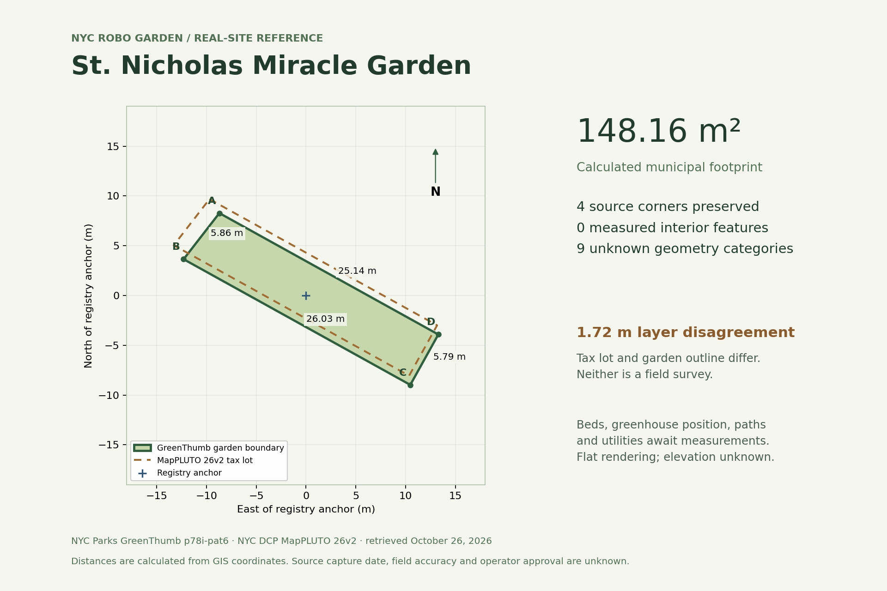

# Real garden layout audit — October 26, 2026

**Use St. Nicholas Miracle Garden as the real-site boundary reference and the first measurement candidate. No reviewed site supports a current, accurate reconstruction of beds, paths and structures.** The committed scene retains the municipal outline and leaves all nine interior categories unknown. It is suitable for explaining the pilot location, not for demonstrating autonomous navigation through that location.

[Open the reference viewer](garden-reference/index.html) · [Open-Industries scene](../data/scenes/st-nicholas-boundary/garden.oi.json) · [Georeference and evidence](../data/scenes/st-nicholas-boundary/garden-georeference.json) · [Machine-readable verification](garden-layout-validation.json)



## What was inspected

The repository at `9845d020492b4a44975bbbe77fd52e705a40a981`, the Hattie Carthan evidence sample, registry/scene/authoring code, all **635 source rows / 634 distinct gardens**, current municipal source metadata, exact-BBL MapPLUTO matches for four shortlisted gardens, and first-party operator/designer pages linked below. Searches for earlier garden plans in the connected file collection returned no matches; that is not proof that no private plan exists. No new operator measurement or permission has been received.

The archived GreenThumb rows have the **same semantic SHA256 as the October 23 run**: `33db25bab786a4bc9f62f06d94964789f66378138610e144fd256e15b5df1dd1`. Retrieval: October 26, 2026; publisher row update: **October 21, 2026, 15:06:10 UTC**. The dataset refresh timestamp does not date individual boundary measurements. MapPLUTO returns **26v2**; the service reports a September 9, 2026 data edit. These are GIS records, not field surveys.

The citywide screen found 634 structurally/topologically valid mapped boundaries, **56 missing location points**, **243 recorded points outside their own polygons**, and **7 boundaries with multiple parts or holes**. An outside point can be an address/entrance reference; it is a review flag, not proof that the polygon is wrong. Interior plans were investigated for the shortlist, not exhaustively for all 634 sites.

## Candidate comparison

All mapped areas below are calculated from the retained WGS84 boundaries, not field measurements. Public municipal vectors have documented reuse policy; this does not license third-party drawings or photographs.

| Candidate / registry ID | Spatial evidence and accuracy limits | Age / completeness | Reuse and Open-Industries feasibility | Decision |
| --- | --- | --- | --- | --- |
| **St. Nicholas Miracle Garden** — `M394-GT001`, 330 Saint Nicholas Ave | Four-vertex polygon, **148.16 m²**. NYC Parks lists **1,595 sq ft** (148.18 m²). MapPLUTO BBL `1019530044` has a 1,596 sq ft attribute, but its polygon differs by **1.72 m** at maximum separation. Website pin is **16.24 m outside** the city outline. | Boundary capture date unknown. Operator and architect describe the greenhouse; no dimensioned, current site plan located. | Municipal boundary reusable with provenance. Operator/designer images remain link-only. Fits current adapter unchanged. | **Best immediate boundary reference and measurement candidate** because of small extent, corroborating area, existing grower relationship and specific workstation task. Mapping disagreement must be resolved before physical placement. |
| **103rd Street Community Garden** — `MGT018`, 105 E 103rd St | SCAPE publishes a layout/scale-bar plan lead and describes four program areas. City polygon **367.47 m²**, exact-BBL parcel polygon about **1,154 m²**, while NYRP reports **15,441 sq ft** (1,434.52 m²). Recorded pin is outside polygon. | Design opened **2011**; NYRP explicitly reports bed upgrades **2019 and 2020**. Old plan cannot establish today's beds. | SCAPE states All Rights Reserved. Request drawing/derivative permission and current revision. Municipal ring fits adapter, but coverage is unresolved. | **Strongest published-plan lead**, not ready for accurate reconstruction. Do not scale the partial GIS outline to fit the larger reported area. |
| **Hattie Carthan Community Garden** — `B400-GT001`, 719 Marcy Ave | Polygon **3,668.29 m²**; exact registry BBL `3017890047` covers a substantially smaller parcel with address **700 Marcy Ave**. Pin is outside polygon; layer separation **34.16 m**. | GrowNYC's **March 28, 2019** addition of 30 beds supplies neither current inventory nor coordinates. | Boundary vector reusable; press-release assets remain link-only. Existing registry anchor exceeds adapter's 100 m room; explicit re-anchoring would be needed after identity/extent review. | Retain historical evidence. Boundary/parcel/address conflict and missing interiors make it weaker for this demo. |
| **Hattie Carthan Herban Farm** — `B572-GT001`, 49 Van Buren St | Distinct **585.85 m²** city polygon; pin inside. Operator name/address match this separate registry record. | Undated operator description; current bed inventory and positions unknown. | Boundary fits adapter; website images/plan rights unresolved. | Resolves the earlier identity lead: use `B572-GT001`, never attach Herban Farm crops to `B400-GT001`. Original October 23 sample is retained as historical research. |
| **Gil Hodges / Carroll Street Garden** — `BGT036`, 534 Carroll St | City polygon **313.77 m²**. NYRP lists **3,007 sq ft**; DEP's 2013 release lists **3,140 sq ft**. Descriptions establish raised beds, permeable paving and stormwater elements, not their measured positions. | Renovation **2013**; current page is undated. | Municipal outline fits adapter. NYRP/Stantec design material needs confirmed drawing rights and as-built revision. | Good infrastructure study candidate; no current dimensioned layout obtained. |
| **Essex Street Community Garden** — `BGT025`, 3030 Fulton St | City polygon **246.12 m²**; NYRP and tax-lot area attribute **3,268 sq ft** (303.61 m²). Exact-BBL parcel polygon is smaller again; layer separation **2.04 m**. | Undated operator page describes solar power, shelter and growing. No measured placements. | Municipal ring fits adapter; operator photos remain link-only. | Useful energy/utility lead, but reconcile extent and obtain plan first. |
| **Red Hook Community Farm / Added Value** — `B126-GT001`, 558 Columbia St | City polygon **10,878.11 m²**, pin inside; registry says **Not GreenThumb**, which does not establish closure. | No interior survey obtained in this audit. | Full boundary exceeds the adapter's 100 m room. Requires an explicitly identified sub-area or larger-scene support. | Lower immediate feasibility; do not silently shrink a real farm. |

Sources: [GreenThumb dataset](https://data.cityofnewyork.us/dataset/GreenThumb-Garden-Info/p78i-pat6), [MapPLUTO service](https://services5.arcgis.com/GfwWNkhOj9bNBqoJ/arcgis/rest/services/MAPPLUTO/FeatureServer/0), [Parks St. Nicholas listing](https://www.nycgovparks.org/opportunities/volunteer/group/st-nicholas-miracle-garden), [SCAPE project](https://www.scapestudio.com/projects/103rd-street-community-garden), [SCAPE plan attachment lead](https://www.scapestudio.com/projects/103rd-street-community-garden/103rd-st_plan_scale-bar-rgb-2/), [NYRP 103rd Street](https://www.nyrp.org/gardens-and-parks/103rd-street-community-garden/), [GrowNYC 2019 release](https://www.grownyc.org/files/gmkt/Press/hattie_carthan_renovation_with_tracy_morgan.pdf), [Herban Farm operator](https://yonnette.wixsite.com/hcherbanfarm/about_us), [NYRP Gil Hodges](https://www.nyrp.org/gardens-and-parks/gil-hodges-community-garden/), [DEP 2013 release](https://www.nyc.gov/html/dep/html/press_releases/13-101pr.shtml), [Stantec project](https://www.stantec.com/en/projects/united-states-projects/g/gil-hodges-community-garden), [NYRP Essex](https://www.nyrp.org/gardens-and-parks/essex-street-community-garden/). The Parks area was available in its indexed first-party listing; direct page access returned HTTP 405. The SCAPE attachment page identifies a scale-bar plan, but no plan was downloaded or digitized. Missing plan access/rights is a limitation, not evidence that a plan does not exist.

## Uptown & Boogie's growing locations

The [operator's greenhouse history](https://uptowngoodfood.com/pages/greenhouse) and [UBHP greenhouse page](https://ubhealthyproject.org/harlem-greenhouse/) connect seedling production to St. Nicholas Miracle Garden. [makeSHIFT's project credits](https://www.studio-makeshift.com/work/st-nicholas-miracle-garden-greenhouse) identify Design Advocates, makeSHIFT Architecture, studio for and Martos Engineering. This supplies a specific route to request original plans and revisions. The operator describes roof repairs, rainwater work and drainage problems, so an early design image alone cannot establish current conditions.

The [Harlem Rooftop Garden](https://ubhealthyproject.org/harlem-rooftop-garden/) is a **shed rooftop project associated with the same garden**, not evidence of another surveyed farm parcel. Its roof outline, structural capacity and as-built status remain unverified. [UBHP's About page](https://ubhp.org/about/) also lists Bronx Park East and Uptown market/CSA programs. Those are distribution/training locations; this audit found no basis to convert them into growing-site layouts.

## Exactly what the scene contains

| Evidence class | Included |
| --- | --- |
| Field-measured features | **None**. No survey or operator measurements have been supplied. |
| Source-backed boundary | All four original GreenThumb corners, unchanged, using the existing registry anchor. One single-ring MultiPolygon is unwrapped to Polygon without simplification or discarded holes. |
| Inferred rendering | A flat LOD0 mesh at local Y=0. Unknown ellipsoidal height uses zero only as the adapter's flagged display assumption. Grid, north arrow and comparison line are annotations, not infrastructure. |
| Unknown interior | Bed inventory/positions, growing areas, paths, greenhouse geometry, shed geometry, water, power, crops and seasonal products. All are explicitly unknown and unrendered. Operator reports of existence remain separate evidence records. |
| Separate comparison | MapPLUTO tax-lot outline shown as a dashed line. It is never substituted for the garden boundary or unioned into the scene. |

The calculated side lengths, in source vertex order A–B–C–D–A, are **5.86, 26.03, 5.79 and 25.14 m**. These are GIS-derived distances, not tape measurements. Maximum boundary/parcel separation is **1.72 m** and polygon intersection-over-union is **0.716**. A Hausdorff distance compares two layers; it is not an estimate of either layer's field error. Agreement between municipal datasets is not independent survey validation.

The [public Open Data FAQ](https://www.nyc.gov/opendata/get-started/FAQs) permits reuse; the [city's technical standards](https://cityofnewyork.github.io/opendatatsm/publicpolicies.html) explain source/version/modification attribution and the accuracy limitations. The source's `licenseId` remains null. The manifest records **permission under published municipal policy**, not a fabricated Creative Commons license. Third-party photographs, architectural images and plans remain links only. Access to the garden and permission to operate robots are separate matters.

## Measurements and permissions needed next

First request the **current greenhouse/site plan and its latest revision from Judi and the design team**. Include permission to use supplied plans/photos to derive geometry, commit derived assets to the public repository, and display them in the demo; retain attribution, scope, date and any redistribution limits. A conversation with the operator does not automatically grant the architect's drawing or photographer's image rights. Confirm garden access for measurement separately. For 103rd Street, the equivalent request is to NYRP and SCAPE, including post-2020 bed changes.

If no usable as-built plan exists, collect this minimum package at St. Nicholas:

| Capture | Required record | What it unlocks |
| --- | --- | --- |
| Site extent and control | Identify visible fence/property corners; measure every side and both diagonals; mark two fixed reference points plus a third independent check point. Record local axes, units, instrument, date, observer and uncertainty. Resolve the city/parcel/website-pin disagreement. | A checked local footprint and a documented geographic transform. Phone GPS alone does not establish centimetre accuracy. |
| Greenhouse and workstation | Exterior and clear interior dimensions; corner offsets to control points; door opening/swing, threshold and aisle widths; bench length/width/height; available arm-mount area; tray datum and camera mount. | The smallest useful seed-tray pilot scene. Calibrate arm/tray/camera coordinates independently of the city map. |
| Beds | Current inventory with stable IDs; each corner or two offsets plus length/width/orientation; height, obstructions and dated overview photographs with scale references. | Bed geometry without turning the 2019 addition count into positions. |
| Circulation | Entrances, narrowest clear widths, steps, slopes, surface changes and fixed/movable obstacles. | A later route feasibility study; no patrol path until this exists. |
| Water, power and terrain | Locate connection points, hose/cable routes and drainage/flooding areas; verify available service with the operator; measure elevation differences. | Utilities and terrain represented with evidence, rather than inferred from equipment photos. |
| Rights and review | Rights-holder permission reference; plan revision; changed/removed features; operator review date and corrections. | Reusable evidence and an explicitly reviewed scene. No signoff has occurred. |

For planning the capture, target **≤5 cm documented uncertainty for static site features** as an initial modeling goal, not a validated clearance guarantee. Set tighter workstation tolerances from the actual tray cell size, tool and robot error budget. Keep raw measurements and independent check residuals; do not hide failure to meet the target. Pilot scope should start at the seeding workstation rather than waiting for a whole-garden patrol reconstruction.

## Reproduce and use

From the repository root (WSL2/Linux):

```bash
python3 -m scripts.build_garden_reference --output data/generated/st-nicholas-reference
python3 -m garden_registry.scene_adapter reload data/generated/st-nicholas-reference
python3 -m http.server 8000
```

Open `http://localhost:8000/docs/garden-reference/` for the committed scene viewer, or import `data/scenes/st-nicholas-boundary/garden.oi.json` through Open-Industries **Drop files or browse**. Keep its georeference sidecar alongside it. The [persisted revision export](../data/scenes/st-nicholas-boundary/persisted.scene.json) is also included. The garden explorer links to this reference. The viewer reuses the repository's Three.js/OrbitControls and loads the actual native scene mesh; it does not generate a separate artistic layout.

To regenerate 3D Tiles with the pinned OI exporter, add `--oi-root ../Open-Industries` to the build command. Use the existing [local import/save/export workflow](garden-scene-adapter.md#local-sqlite-save-restart-and-export) with this package. The conceptual robot/seed-station animation remains a separate simulation; it has not been placed into unknown real aisles or beds.

Independent GIS checks:

```bash
python3 -m pip install -r requirements-layout-validation.txt
python3 -m scripts.verify_garden_reference data/scenes/st-nicholas-boundary --output data/generated/st-nicholas-checks.json
python3 -m unittest discover -s tests -p test_garden_reference.py -v
```

Validation covers source snapshot replay/hashes, exact vertex retention, polygon topology, triangulation coverage without overlapping area, normalization/placement, independent PROJ coordinate conversion, geodesic versus mesh area, no invented interior instances, nine retained unknowns, and deterministic native package reload. Native OI import/export/reopen, local SQLite MCP save and fresh-process export/reopen, and the upstream 3D Tiles exporter were also exercised. The 31 relevant Python tests passed. Desktop/mobile Chromium checks passed with no page errors, failed asset requests or horizontal overflow; plan/orbit/reset and layer toggles were checked. [Integration results](garden-layout-integration.json) retain the pinned OI revision and actual local save receipt. These are software/data checks; no field survey, calibrated scene alignment or physical robot trial was performed.

Suggested demo caption: **“St. Nicholas Miracle Garden: NYC Parks boundary reference linked to our seed-tray pilot research. Interior measurements and operator review are pending; robot motion remains a separate simulation.”**
